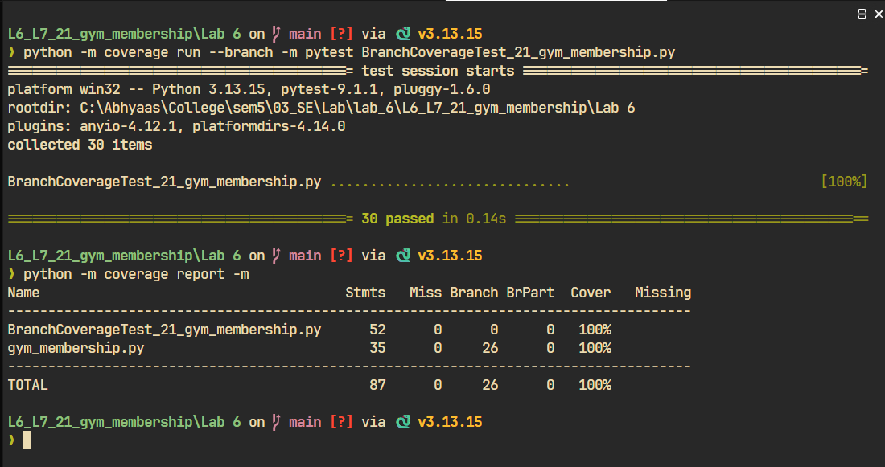

# Branch Coverage Report — Gym Membership

**Lab 6: Code and Branch Coverage**
**SRN:** PES1UG24CS444
**Repository:** `KadakWNL/L6_L7_21_gym_membership`
**Module under test:** `gym_membership.py`
**Test suite:** `BranchCoverageTest_21_gym_membership.py`

## Objective

Verify that every decision point in `gym_membership.py` is exercised in **both**
directions — every `if`/`elif` evaluates to True at least once and False at
least once — and reach at least 90% branch coverage.

## Method

```bash
rm -f .coverage
python -m coverage run --branch -m pytest BranchCoverageTest_21_gym_membership.py
python -m coverage report -m
```

`--branch` must be passed to `coverage run`, since branch data is recorded
during execution, not during reporting. The suite contains 30 tests, using
`pytest.mark.parametrize` for boundary cases.

## Decision coverage

### `membership_cost`

| Decision | True case | False case |
|----------|-----------|------------|
| `plan not in PLAN_PRICE` | `"weekly"` → `ValueError` | `"monthly"`, `"quarterly"`, `"yearly"` |
| `age < 14` | ages 0 and 13 → `ValueError` | age 14 (boundary) |
| `age >= 60` | age 60 (boundary) → 25% off | age 59 |
| `elif is_student` | age 59, student → 10% off | age 59, non-student |
| `with_trainer` | trainer added | no trainer |
| `plan == "yearly"` | yearly + trainer → extra 500 off | quarterly + trainer |

Senior and student discounts are an `if`/`elif` pair, so a 60-year-old student
receives the senior discount only. This is tested explicitly.

### `can_enter`

| Decision | True case | False case |
|----------|-----------|------------|
| `not plan_active` | inactive plan → `False` | active plan |
| `hour < 5` | hour 4 → `False` | hour 5 (boundary) |
| `hour > 22` | hour 23 → `False` | hour 22 (boundary) |
| `is_women_only_slot` | female allowed, male denied | regular slot allows both |

Both sides of the `or` in `hour < 5 or hour > 22` are tested separately, because
short-circuit evaluation means hour 4 never evaluates the second condition.

### `bmi_category`

| Decision | True case | False case |
|----------|-----------|------------|
| `height_m <= 0` | heights 0 and -1.5 → `ValueError` | positive height |
| `bmi < 18.5` | bmi 18.49 | bmi 18.5 |
| `bmi < 25` | bmi 18.5 and 24.99 | bmi 25.0 |
| `bmi < 30` | bmi 25.0 and 29.99 | bmi 30.0 |

Boundary values are chosen on both sides of each threshold, since a classification
bug typically appears exactly at the boundary (18.5, 25, 30) rather than in the
middle of a band.

## Result

```
Name                                      Stmts   Miss Branch BrPart  Cover   Missing
-------------------------------------------------------------------------------------
BranchCoverageTest_21_gym_membership.py      52      0      0      0   100%
gym_membership.py                            35      0     26      0   100%
-------------------------------------------------------------------------------------
TOTAL                                        87      0     26      0   100%
```



`gym_membership.py` reaches **100% branch coverage: 26 of 26 branches, 0
partial**. This exceeds the 90% requirement in the handout.

## Conclusion

All 13 decision points are covered in both directions, including the three BMI
thresholds and the opening/closing hour boundaries. No partially covered branch
remains.
