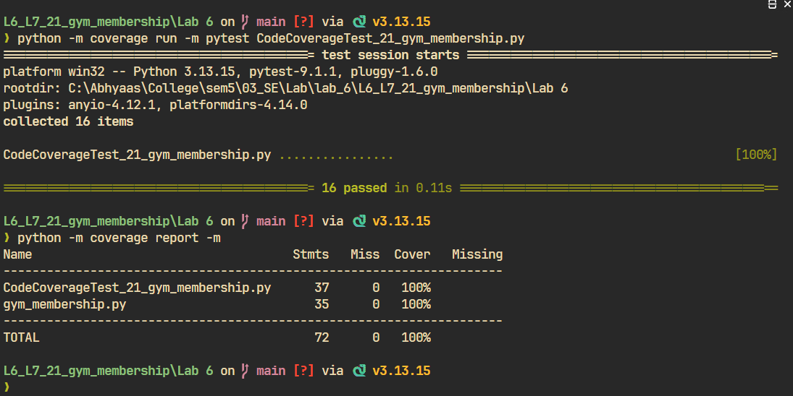

# Code Coverage Report — Gym Membership

**Lab 6: Code and Branch Coverage**
**SRN:** PES1UG24CS444
**Repository:** `KadakWNL/L6_L7_21_gym_membership`
**Module under test:** `gym_membership.py`
**Test suite:** `CodeCoverageTest_21_gym_membership.py`

## Objective

Measure how much of `gym_membership.py` is executed by the test suite, and raise
line coverage to at least 90% by adding tests for the untested statements.

## Environment

| Item | Version |
|------|---------|
| Python | 3.13.15 |
| pytest | 9.1.1 |
| coverage.py | 7.17.1 |
| Shell | Git Bash (Windows) |

## Method

```bash
rm -f .coverage
python -m coverage run -m pytest CodeCoverageTest_21_gym_membership.py
python -m coverage report -m
```

The suite contains 16 tests, organised around the three public functions of the
module.

## Test design

| Function | Scenarios covered |
|----------|-------------------|
| `membership_cost` | Unknown plan rejected; age below 14 rejected; plain monthly member; senior discount; student discount; trainer add-on; yearly plan with trainer |
| `can_enter` | Inactive plan denied; before opening time denied; women-only slot with female member; regular slot |
| `bmi_category` | Invalid height rejected; underweight; normal; overweight; obese |

## Result

```
Name                                    Stmts   Miss  Cover   Missing
---------------------------------------------------------------------
CodeCoverageTest_21_gym_membership.py      37      0   100%
gym_membership.py                          35      0   100%
---------------------------------------------------------------------
TOTAL                                      72      0   100%
```



`gym_membership.py` reaches **100% line coverage (35/35 statements)**, with no
lines reported missing. This exceeds the 90% requirement in the handout.

## Analysis

Every statement in the module is reachable through the public API, so the suite
covers all of them. The two `raise` statements are exercised with
`pytest.raises`, and the four BMI bands are reached with weights chosen so the
computed BMI falls into each range.

One observation: because every `if`/`elif` in this module has a distinct
statement on each side, executing all statements also forces all decision
outcomes. That means a suite built purely for line coverage happens to reach
100% branch coverage here as well — the two metrics coincide for this module.
The separate `BranchCoverageTest_21_gym_membership.py` suite exists to make that
coverage deliberate rather than incidental, and to test the boundary values
that line coverage does not force you to consider.

## Conclusion

Code coverage target met at 100% with 16 tests. No untested statements remain in
`gym_membership.py`.
